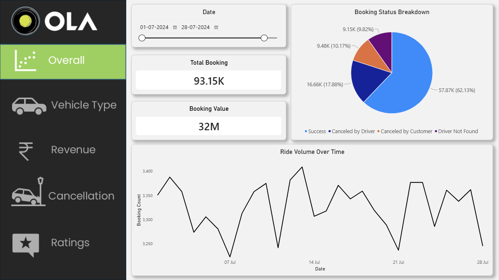
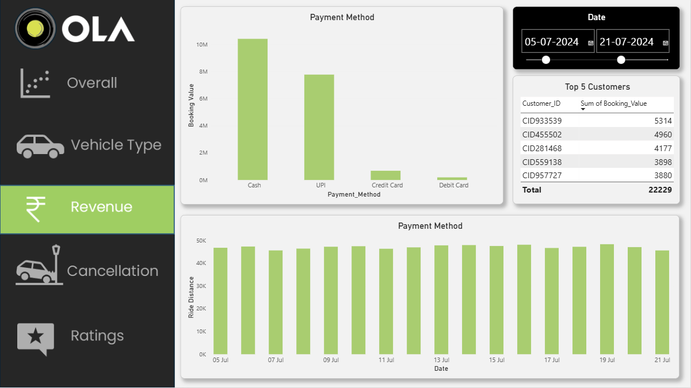
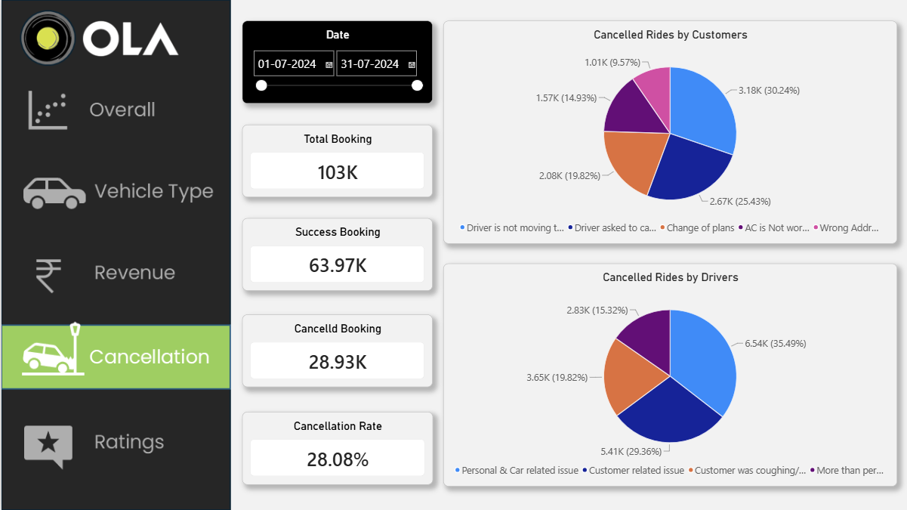
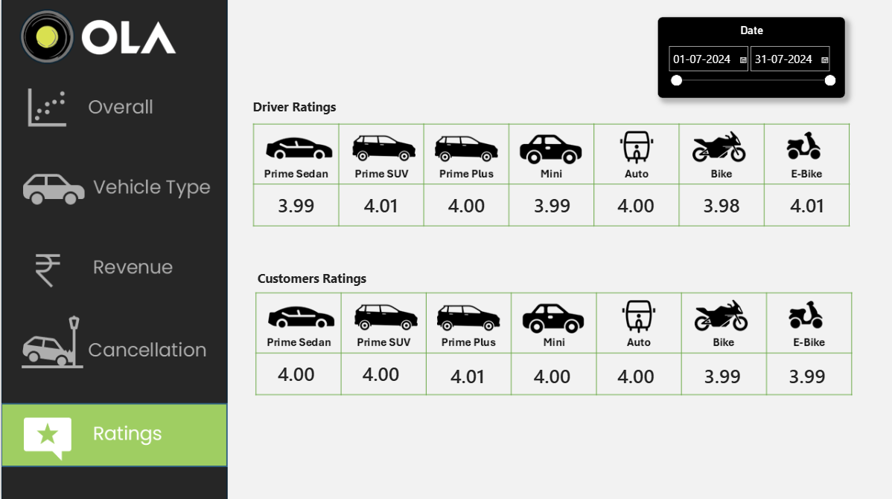

# 🚖 OLA Ride Booking Data Analytics Project

An end-to-end data analytics project focused on analyzing OLA ride-booking data using **SQL and Power BI**. This project explores booking trends, vehicle performance, revenue, cancellations, and customer and driver ratings through interactive dashboards and SQL queries.

The goal is to transform ride-booking data into meaningful insights that help understand operational performance and customer behavior.

---

## 📌 Table of Contents

- [Project Overview](#-project-overview)
- [Project Objectives](#-project-objectives)
- [Tools and Technologies](#-tools-and-technologies)
- [Repository Structure](#-repository-structure)
- [Dataset Description](#-dataset-description)
- [Power BI Dashboard](#-power-bi-dashboard)
- [SQL Analysis](#-sql-analysis)
- [Key Metrics](#-key-metrics)
- [How to Run the Project](#-how-to-run-the-project)
- [Skills Demonstrated](#-skills-demonstrated)
- [Future Improvements](#-future-improvements)
- [Author](#-author)

---

## 📖 Project Overview

This project analyzes OLA ride-booking data for Bengaluru to understand booking performance, revenue generation, vehicle-type performance, cancellation behavior, and customer satisfaction.

The project combines SQL-based data analysis with an interactive Power BI dashboard to present key performance indicators (KPIs), trends, and comparisons.

The dashboard is divided into five main sections:

1. Overall Analysis
2. Vehicle Type Analysis
3. Revenue Analysis
4. Cancellation Analysis
5. Ratings Analysis

Users can explore the data using date filters and visualizations to understand different aspects of ride-booking operations.

---

## 🎯 Project Objectives

- Analyze total bookings and successful bookings.
- Understand booking-status distribution.
- Track daily ride-booking trends.
- Compare booking value and distance across vehicle types.
- Analyze revenue by payment method.
- Identify top customers based on booking value.
- Investigate customer and driver cancellation reasons.
- Compare driver and customer ratings across vehicle categories.
- Use SQL queries to extract meaningful business information.
- Build an interactive Power BI dashboard for data-driven analysis.

---

## 🛠️ Tools and Technologies

| Tool | Purpose |
|---|---|
| Power BI | Interactive dashboards and data visualization |
| SQL | Data querying, filtering, aggregation, and analysis |
| CSV | Storage of booking datasets |
| DAX / Power BI calculations | KPI calculations and dashboard metrics, where used |
| GitHub | Project version control and documentation |

---

## 📂 Repository Structure

```text
Ola-Project/
│
├── Dataset/
│   ├── Bookings 2k.csv
│   └── Bookings.csv
│
├── Image/
│   ├── Cancellation.png
│   ├── Overall.png
│   ├── Ratings.png
│   ├── Revenue.png
│   └── Vehicle Type.png
│
├── Ola Project.pbit
├── Ola Project.sql
└── README.md
```

### Files and Folders

- **Dataset/** — Contains the booking datasets in CSV format.
- **Image/** — Contains screenshots of the five Power BI dashboard pages.
- **Ola Project.pbit** — Power BI report template.
- **Ola Project.sql** — SQL queries used for booking-data analysis.
- **README.md** — Project documentation.

---

## 📊 Dataset Description

The project documentation describes ride-booking records containing fields related to bookings, customers, vehicles, payments, cancellations, and ratings.

Important fields include:

| Column | Description |
|---|---|
| Date | Date of the booking |
| Time | Booking time |
| Booking_ID | Unique booking identifier |
| Booking_Status | Status of the booking |
| Customer_ID | Customer identifier |
| Vehicle_Type | Type of vehicle booked |
| Pickup_Location | Ride pickup location |
| Drop_Location | Ride destination |
| V_TAT | Vehicle arrival time metric |
| C_TAT | Customer arrival time metric |
| cancelled_Rides_by_Customer | Customer cancellation indicator |
| cancelled_Rides_by_Driver | Driver cancellation reason |
| Incomplete_Rides | Incomplete-ride indicator |
| Incomplete_Rides_Reason | Reason for an incomplete ride |
| Booking_Value | Booking value |
| Payment_Method | Payment method used |
| Ride_Distance | Distance travelled |
| Driver_Ratings | Rating given to the driver |
| Customer_Rating | Customer rating |

The dataset includes vehicle categories such as Prime Sedan, Prime SUV, Prime Plus, Mini, Auto, Bike, and E-Bike.

---

## 📈 Power BI Dashboard

The Power BI report contains five dashboard pages designed to explore different business metrics.

### 1. Overall Analysis

Provides a high-level overview of ride-booking performance.

**Key visualizations:**
- Total bookings
- Booking value
- Booking-status breakdown
- Ride volume over time
- Date-range filtering



### 2. Vehicle Type Analysis

Compares the performance of different vehicle categories.

**Key visualizations:**
- Total booking value by vehicle type
- Successful booking value by vehicle type
- Average distance travelled
- Total distance travelled


### 3. Revenue Analysis

Explores booking-value patterns and payment behavior.

**Key visualizations:**
- Booking value by payment method
- Top five customers by total booking value
- Ride-distance trends by date
- Date-range filtering



### 4. Cancellation Analysis

Examines ride cancellations and their possible causes.

**Key visualizations:**
- Customer cancellation reasons
- Driver cancellation reasons
- Cancellation counts
- Cancellation rate



### 5. Ratings Analysis

Compares customer and driver ratings across vehicle categories.

**Key visualizations:**
- Driver ratings by vehicle type
- Customer ratings by vehicle type
- Comparison of ratings across vehicle categories



---

## 🧮 SQL Analysis

SQL is used to answer business questions related to booking performance, vehicle categories, customer behavior, payments, cancellations, and ratings.

The SQL file contains queries corresponding to questions such as:

1. Retrieve all successful bookings.
2. Calculate the average ride distance for each vehicle type.
3. Count rides cancelled by customers.
4. Find the top five customers by number of rides.
5. Count driver cancellations caused by personal or car-related issues.
6. Find the maximum and minimum driver ratings for Prime Sedan bookings.
7. Retrieve bookings paid for using UPI.
8. Calculate average customer ratings by vehicle type.
9. Calculate the total booking value of successful rides.
10. Retrieve incomplete rides along with their reasons.

### Sample SQL Queries

#### 1. Retrieve Successful Bookings

```sql
SELECT *
FROM bookings
WHERE Booking_Status = 'Success';
```

#### 2. Average Ride Distance by Vehicle Type

```sql
SELECT
    Vehicle_Type,
    AVG(Ride_Distance) AS avg_distance
FROM bookings
GROUP BY Vehicle_Type;
```

#### 3. Count Customer-Cancelled Rides

```sql
SELECT COUNT(*)
FROM bookings
WHERE Booking_Status = 'Cancelled by Customer';
```

> Check the exact spelling and capitalization of the status values in your dataset before executing this query.

#### 4. Top Five Customers by Number of Rides

```sql
SELECT
    Customer_ID,
    COUNT(Booking_ID) AS total_rides
FROM bookings
GROUP BY Customer_ID
ORDER BY total_rides DESC
LIMIT 5;
```

#### 5. Successful Booking Value

```sql
SELECT
    SUM(Booking_Value) AS total_successful_ride_value
FROM bookings
WHERE Booking_Status = 'Success';
```

#### 6. Customer Ratings by Vehicle Type

```sql
SELECT
    Vehicle_Type,
    AVG(Customer_Rating) AS avg_customer_rating
FROM bookings
GROUP BY Vehicle_Type;
```

#### 7. Retrieve UPI Bookings

```sql
SELECT *
FROM bookings
WHERE Payment_Method = 'UPI';
```

#### 8. Incomplete Rides and Reasons

```sql
SELECT
    Booking_ID,
    Incomplete_Rides_Reason
FROM bookings
WHERE Incomplete_Rides = 'Yes';
```

**Note:** These examples follow the field names and analysis questions described in the project documentation. Use the exact table names, column names, and status values from `Ola Project.sql` and your database.

---

## 📌 Key Metrics

The following figures are visible in the provided dashboard screenshots. They represent the displayed filter selections and are not guaranteed to remain the same when the date range changes.

| Metric | Displayed Value |
|---|---:|
| Total Bookings — Overall page | 93.15K |
| Booking Value — Overall page | 32M |
| Cancelled Bookings — Cancellation page | 28.93K |
| Cancellation Rate — Cancellation page | 28.08% |
| Driver and Customer Ratings | Generally around 4.0 |

### Business Questions Explored

- How does booking volume change over time?
- Which vehicle categories generate the highest booking value?
- How does booking value vary by payment method?
- What are the major reasons for customer and driver cancellations?
- Which customers contribute the highest booking value?
- How do customer ratings compare across vehicle categories?
- What is the relationship between ride distance and vehicle type?

---

## 🚀 How to Run the Project

### Step 1: Clone the Repository

```bash
git clone https://github.com/ashishprajapati2006/Ola-Project.git
```

Replace `Ola-Project` with your actual repository name if it differs.

### Step 2: Open the Project Folder

```bash
cd Ola-Project
```

### Step 3: Open the Power BI Template

1. Install Power BI Desktop.
2. Open `Ola Project.pbit`.
3. Follow the prompts to connect to or load the required dataset.
4. Confirm the data source paths and refresh the data if required.
5. Navigate through the dashboard pages and use the date filters.

**Important:** A `.pbit` file is a Power BI template, not the same as a `.pbix` report. You may need to configure the data source before the dashboard can be viewed.

### Step 4: Run the SQL Queries

1. Open `Ola Project.sql` in your SQL editor.
2. Configure the database connection.
3. Load the appropriate CSV data into a table named `bookings`, or update the queries to match your table.
4. Execute the queries to reproduce the analysis.

The SQL syntax may need minor changes depending on whether you use MySQL, SQL Server, PostgreSQL, or another database system.

---

## 💡 Skills Demonstrated

This project demonstrates practical skills in:

- Data analysis and exploratory analysis
- SQL queries and aggregations
- Filtering, grouping, and sorting data
- Business KPI analysis
- Power BI dashboard development
- Data visualization and trend analysis
- Customer behavior and cancellation analysis
- Revenue and vehicle-performance analysis
- Data storytelling and project documentation
- GitHub repository management

---

## 🔮 Future Improvements

Potential improvements for future versions include:

- Add more detailed time-based booking comparisons.
- Build a dedicated vehicle-performance ranking page.
- Analyze cancellation patterns by location and time.
- Add more detailed payment-method comparisons.
- Create a customer-retention analysis.
- Improve dashboard navigation and mobile-friendly presentation.
- Add a written business-insights report with verified findings.

---

## 👨‍💻 Author

**Ashish Prajapati**

B.Tech — Information Technology

- **GitHub:** [ashishprajapati2006](https://github.com/ashishprajapati2006)
- **LinkedIn:** [ashishprajapati27](https://www.linkedin.com/in/ashishprajapati27)

---

## ⭐ Support

If you find this project useful or informative, consider giving the repository a ⭐ on GitHub.

**Thank you for visiting the OLA Ride Booking Data Analytics Project!**
